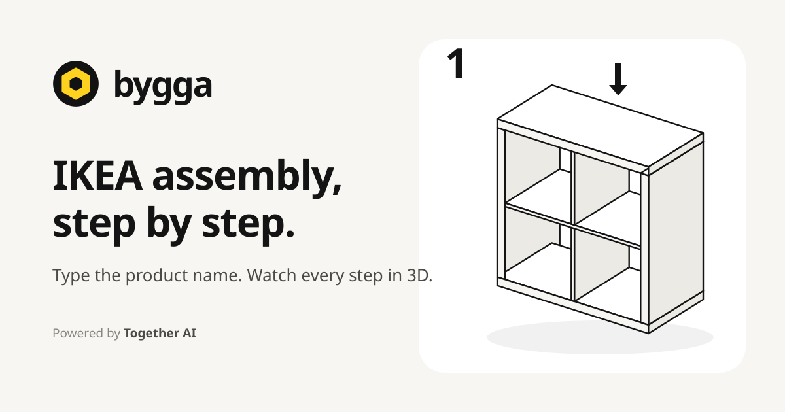

  

<h1 align="center">Bygga</h1>

Type the name or article number on an IKEA box and follow every assembly step in 3D, drawn like the paper manual and read out loud. <a href="https://bygga-eta.vercel.app">bygga-eta.vercel.app</a>

## Tech stack

- Next.js 16 (App Router, Cache Components) with React 19 and TypeScript, plain CSS with Motion and Lucide icons, no UI kit
- three.js line-art stage (`src/engine`): ink outlines, fly-in parts, a zoomed callout per fitting, offscreen thumbnails
- A parametric plan generator (`src/lib/plan`) for 7 furniture types and 74 kinds: 1,171 IKEA products (2,180 sizes, UK and US ranges) drawn offline, with typo-tolerant search and article numbers
- IKEA's public product listings (`scripts/ikea`): `npm run ikea:fetch` downloads them locally (they are git ignored, see NOTICE), `classify.ts` maps name, type and size to kinds, `npm run ikea:build` writes the catalog rows in `src/data`, and `npm run ikea:check` tests them; every IKEA family name is known, so MARKUS reads as an office chair and never as a typo of MARIUS
- Manual scanner (`/scan`, parked for v2 and off unless `NEXT_PUBLIC_SCAN=1`): a vision model reads each page, `gpt-oss-120b` lays out the parts in millimetres, and `src/lib/plan/custom.ts` places every dowel, bolt and screw where parts touch
- Together AI on each visitor's own key (`src/components/KeyModal.tsx` asks for it, about a cent a build): unknown product names (steered by IKEA's own type), photo lookup, and a help chat whose answers come with drawings of the exact panel, fitting or step from the guide (`[part B]` tags, `readAnswer` in `src/components/guide/HelpSheet.tsx`), with model fallback lists in `src/lib/together.ts`
- A hands-free voice on Together AI (Kokoro, `src/lib/voice/tts.ts`): every catalog line is pre-recorded with `npm run voice` (1,476 clips cover all 2,180 guides) and reads aloud with no key, the rest are recorded live, product names keep phonetic spellings where they help (`npm run voice:names`), and saying "next" turns the page, even while she is talking: the page listens through an echo-cancelled mic, sends each bit of talk to Whisper on Together (`/api/listen`), and sets her own words aside by when she said them (`hearIntent` in `src/lib/voice/commands.ts`), the same in every browser. `npm run voice:check` replays 283 recorded runs through it
- Workshop (`/builds`): every finished build merged into one scene and rendered at true scale next to a person
- Share cards drawn by the engine (`scripts/og/render.mjs`, `src/lib/og`), a picture of your finished build to post, an A4 print view, and a service worker so opened guides work with no signal

## Cloning & running

1. Clone: `git clone https://github.com/Luffixos/bygga.git && cd bygga && npm install`
2. Optional key: `cp .env.example .env.local`, then set `TOGETHER_API_KEY`, and paste `bygga-dev-mock-key-000000` into the app's key box: under `npm run dev` it stands for your `.env.local` key (the 2,180 offline guides and the read-aloud voice work without one)
3. Run: `npm run dev`, open http://localhost:3000 and type `BISSA`
4. Jump to a step: http://localhost:3000/build/malm-3-drawers?step=12, print one at `/build/malm-3-drawers/print`, or see finished builds at `/builds`
5. Try the scanner free: run with `NEXT_PUBLIC_SCAN=1`, then on `/scan` paste the same dev key and add any photo (only `npm run dev` accepts it)
6. Rebuild the catalog from IKEA's listings (only needed when they change): `npm run ikea:fetch && npm run ikea:build && npm run ikea:check`
7. Before pushing: `npm run lint && npm run build`

## Roadmap

- [x] let people flag a step that doesn't match their box (logged as `[feedback]`)
- [x] a print view: the whole guide on A4
- [x] cache AI product reads on the server so the second person to ask gets them instantly
- [x] every AI feature on the visitor's own Together key, and help answers with pictures of the part
- [x] teach the generator corner sofas, sliding doors, office chairs, day-beds, kitchen and bathroom cabinets
- [ ] the last odd shapes `scripts/ikea/skips.ts` lists: three-cornered shelves, corner combinations and PAX widths that don't split into frames
- [ ] the voice in more languages
- [ ] test the scanner on a stack of real manuals and bring it back in v2
- Real IKEA PDFs are not scraped or mirrored on purpose: every guide is generated, and the cover links to the product on ikea.com, where the official manual is.

## Security

The site has no Together key of its own in production: every AI call runs on the visitor's key, which stays in their `localStorage`, travels only in an `x-together-key` header, and is never stored or logged. Every `/api/*` route answers only the site's own pages and is rate limited per IP, and the pages send a strict Content Security Policy. Scanned guides and build progress live in the browser too, and a shared scan carries the guide inside its link. What the site keeps and sends where is spelled out on [/privacy](https://bygga-eta.vercel.app/privacy).

MIT licensed, see [LICENSE](LICENSE). Bygga is not affiliated with IKEA: IKEA and its product names are trademarks of Inter IKEA Systems B.V., and the license grants no rights in them (see [NOTICE](NOTICE)).
